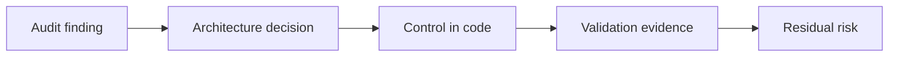
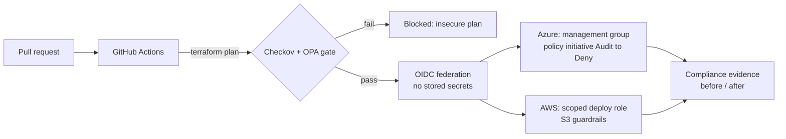

# Cloud Guardrails Lab — Azure + AWS

**John Hilton Jr.** · Cloud Security Engineer · [LinkedIn](https://www.linkedin.com/in/johnhilton1/)

## Why I'm building this

I'm a cloud security engineer working toward cloud security architecture. In my day-to-day work I design governance, identity and policy controls in Azure. This lab is where I prove those skills end to end, in the open, with evidence anyone can check.

Architecture isn't the diagram alone. It's the decision behind the diagram, the control that enforces it, and the evidence that the control works. Every part of this lab follows that chain:

## The scenario

[**Harbor & Pine Insurance**](docs/scenario.md) is a fictional regional insurer. It runs on Microsoft 365 and three Azure subscriptions that different teams built without shared standards. It has just acquired QuoteFast, a small startup whose app runs in AWS. An internal audit found four problems:

| # | Finding |
|---|---|
| F-1 | A storage account holding policyholder documents allows public network access |
| F-2 | The deployment pipeline signs in with a client secret that hasn't been rotated in two years |
| F-3 | Resource groups have no consistent owner tag |
| F-4 | Test resources were deployed outside approved US regions |

The business also wants to adopt a new SaaS claims tool. As the newly hired Cloud Security Architect, I need to close the findings, stop them from recurring, bring the acquired AWS account up to the same baseline, and give the business a safe way to onboard new SaaS. The constraints: **don't break production, automate everything, and buy nothing new.**

## What this lab demonstrates

| Capability | How it's shown |
|---|---|
| Organization-wide guardrails | Azure Policy initiative at management-group scope, managed in Terraform, rolled out Audit → Deny |
| Preventing insecure deployments | A CI gate (Checkov + OPA) that rejects an insecure Terraform plan before it reaches the cloud |
| Finding and fixing misconfigurations | Seeded problems remediated with the right pattern for each, measured before and after |
| Securing automation identities | Secretless deployment through OIDC federation, with a threat model whose checks are actually tested |
| Multi-cloud | The same control intent carried into AWS through the same CI gate |
| Guiding teams and leadership | A one-page SaaS onboarding standard and a one-page executive memo |

## Target architecture

## Architecture artifacts I will produce

Each is one page or one diagram. Templates are in [`docs/templates/`](docs/templates/).

| # | Artifact | Why it matters | Status |
|---|---|---|---|
| 1 | Current-state diagram | Shows where each audit finding lives before anything changes | Planned |
| 2 | Target-state architecture diagram | The design the rest of the lab implements | Planned |
| 3 | Control catalog with traceability | Every finding traced to a control, the code that enforces it, and its evidence | Started |
| 4 | ADR-001: assignment scope and enforcement | Where guardrails are assigned, and how to enforce without breaking production | Planned |
| 5 | ADR-002: plan identity on pull requests | How to scan plans in CI without giving PRs a deployment identity | Planned |
| 6 | Before/after compliance record | Measured results, not claims | Planned |
| 7 | Exception rule | How justified exceptions are approved and expire | Planned |
| 8 | Threat model: deployment pipeline | STRIDE threats for the pipeline, each one tested | Planned |
| 9 | ADR-003: federation vs. stored secrets | Why federation, and what risk remains | Planned |
| 10 | Azure ↔ AWS control mapping | The same control intent in both clouds, and where they differ | Planned |
| 11 | SaaS and workload onboarding standard | A one-page review standard teams can actually follow | Planned |
| 12 | Executive memo to the CISO | Results, residual risk, and the decision leadership needs to make | Planned |

## Modules

| Module | Closes | Status |
|---|---|---|
| [1 — Guardrails as code and the CI gate](modules/01-guardrails-as-code/) | F-1, F-3, F-4 (prevention) | Planned |
| [2 — Detect and remediate](modules/02-detect-and-remediate/) | F-1, F-3, F-4 (existing resources) | Planned |
| [3 — Secretless pipelines](modules/03-secretless-pipelines/) | F-2 | Planned |
| [4 — Same guardrails in AWS](modules/04-aws-translation/) | Acquired AWS account | Planned |
| [5 — Onboarding standard and executive memo](modules/05-onboarding-standard/) | SaaS request | Planned |

## Standards for this repo

- **Evidence or it didn't happen.** Every claim links to code, a CI run, or a measured result.
- **One page per artifact.** If it doesn't fit, the decision is too big.
- **Fictional and clean.** No real company, tenant, subscription or account identifiers.
- **Torn down after testing.** Lab resources are destroyed after each module; costs stay near zero.

## Out of scope for this lab

Conditional Access as code, Microsoft Purview, Defender for Cloud paid plans, and Microsoft Sentinel.
# Cloud-Guardrails-Lab
