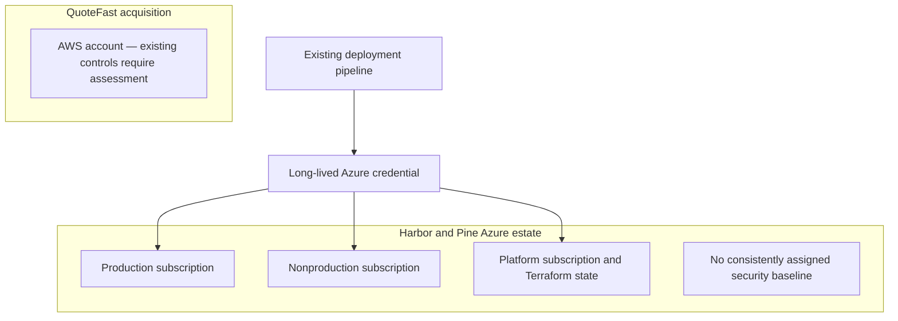
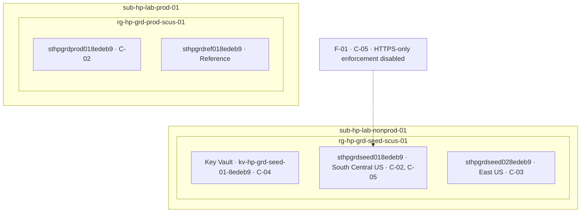

# HarborPine Azure Environment — Before Remediation

## Scenario architecture before guardrails

This view represents the scenario's starting conditions. The pipeline
secret is a modeled scenario risk, not a claim that a live secret was
found in this repository.

| Starting gap | Where it appears |
|---|---|
| Missing Owner tag — C-01 | Nonproduction seed resource group |
| Storage public-network access — C-02 | Production and nonproduction storage |
| Unapproved location — C-03 | East US seed storage account |
| Key Vault public-network access — C-04 | Nonproduction seed vault |
| Secure transfer disabled — C-05 | Nonproduction seed storage |
| Long-lived deployment credential | Scenario pipeline |
| Acquisition governance boundary | QuoteFast AWS account |

The resource diagram below shows the observed Azure seed baseline.
Scenario finding IDs and observed resource finding IDs must be traced
through the findings register rather than assumed to be interchangeable.

## Observed seed resources

