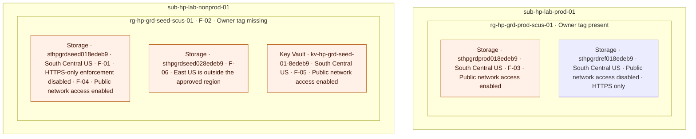

# Harbor & Pine Insurance — Azure Current State

**Module 1 · Before remediation · November 22, 2026**

The baseline covers two Azure subscriptions, two resource groups, and five resources. South Central US (`southcentralus`) is the only approved region for the evaluated subscriptions. The sandbox subscription is outside this evidence capture.

Nested boxes show Azure scope. A finding appears at the level where it was observed. F-02 applies to the nonprod resource group, and F-06 applies to the East US storage account inside it.

See the [findings register](findings-register.md) for control mappings, baseline results, and closure criteria.
