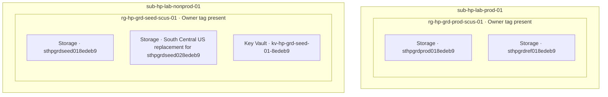

# Harbor & Pine Insurance — Azure Target State

**Module 1 · Planned configuration**

The target covers the production and non-production subscriptions evaluated in the November 22 baseline. South Central US (`southcentralus`) is the only approved Azure region for this scope. Each resource group has an `Owner` tag. All four target storage accounts require HTTPS and disable public network access. The Key Vault also disables public network access.

[Current-state diagram](current-state.md) · [Findings register](findings-register.md) · [Control catalog](scenario.md)

The boxes show Azure scope. Every resource shown is intended to run in South Central US. The replacement storage account name will be chosen during implementation.

## Finding closure

| Finding | Control | Target change | Closure evidence |
| --- | --- | --- | --- |
| F-01 | C-05 | Require HTTPS on `sthpgrdseed018edeb9`. | Retest clients and capture `enableHttpsTrafficOnly = true`. |
| F-02 | C-01 | Tag `rg-hp-grd-seed-scus-01` with its accountable owner. | Capture the nonprod group with the `Owner` tag present. |
| F-03 | C-02 | Disable public network access on `sthpgrdprod018edeb9`. | Validate production workload access over the approved private path and capture `publicNetworkAccess = Disabled`. |
| F-04 | C-02 | Disable public network access on `sthpgrdseed018edeb9`. | Validate dependent access and capture `publicNetworkAccess = Disabled`. |
| F-05 | C-04 | Disable public network access on `kv-hp-grd-seed-01-8edeb9`. | Validate dependent workload access over the approved private path and capture `publicNetworkAccess = Disabled`. |
| F-06 | C-03 | Replace the East US storage deployment with a South Central US account. | Verify any required data and clients after cutover. Recapture inventory after retiring the East US deployment and confirm all five in-scope resources are in `southcentralus`. |

## Rollout and verification

Prepare private connectivity and DNS for workloads that need access before disabling public endpoints. Test the changes in nonprod first, then verify production dependencies and application access during the production rollout. Retain the original baseline and capture new evidence after remediation.

For the five-resource target shown above, the expected post-remediation results are C-01 **2/2**, C-02 **4/4**, C-03 **5/5**, C-04 **1/1**, and C-05 **4/4**. These are planned outcomes pending the post-remediation check.
