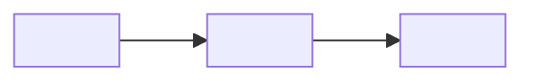

# Threat Model — <System, e.g. "Harbor & Pine deployment pipeline">

**Status:** Designed | Validated
**Date:** YYYY-MM-DD
**Closes / relates to:** <e.g. F-2, C-06>

<!-- One page. A threat model nobody finishes reading protects nothing. -->

## Scope

<!-- One question this model answers, e.g. "Can the pipeline deploy without a stored secret, and only to what it should?" State what is out of scope. -->

## Data flow and trust boundaries

<!-- Then 2–3 bullets: where trust changes hands, and what enforces it at each boundary. -->

## Threats

| ID | STRIDE | Threat (one line) | Priority | Treatment | Owner | Test | Result |
|---|---|---|---|---|---|---|---|
| TM-01 | Spoofing | | High / Med / Low | | | <how you'll prove it> | <pass / fail + link> |
| TM-02 | Tampering | | | | | | |
| TM-03 | Elevation of privilege | | | | | | |
| TM-04 | Information disclosure | | | | | | |
| TM-05 | Repudiation | | | | | | |

<!-- Five threats is enough. Denial of service can be added if it changes a design choice. -->

## Residual risk

<!-- 2–3 sentences. What remains true even with every treatment in place? e.g. "A compromised approved job can act within its permissions until its token expires." Who accepts that risk? -->

## Revisit when

<!-- e.g. new repository, new environment, broader permissions, self-hosted runners. -->
